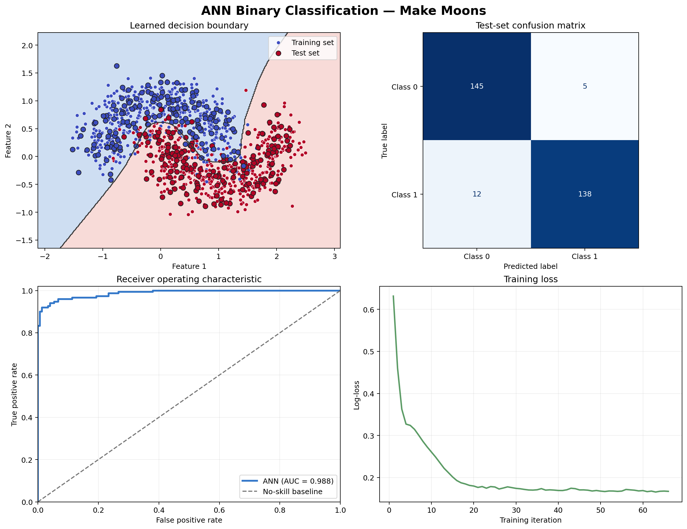

# ANN Binary Classification Using the Make Moons Dataset

This project trains an artificial neural network (ANN) to classify the two
interleaving crescent-shaped classes in scikit-learn's Make Moons dataset. The
curved class boundaries make this a compact example of nonlinear binary
classification.

## Results

With the fixed random seed and settings in the script, the model achieved
**94.33% accuracy** on a held-out test set of 300 examples. Its ROC-AUC was
**0.9878**. The run also reports macro precision, recall, F1, and a per-class
classification report. Results are reproducible with the same library versions.



## Model and workflow

- 1,200 generated observations with noise level 0.25
- Stratified 75/25 train/test split and fixed random seed
- StandardScaler preprocessing
- Scikit-learn MLPClassifier with two 64-neuron hidden layers
- ReLU activation, Adam optimizer, and early stopping
- Evaluation metrics: accuracy, macro precision, macro recall, macro F1, and ROC-AUC
- Charts: decision boundary, confusion matrix, ROC curve, and training loss

## Run

Install dependencies:

```bash
python -m pip install -r requirements.txt
```

Run the project:

```bash
python ann_make_moons.py
```

The script prints metrics and saves `make_moons_ann_results.png` beside the
script. To choose a different chart path:

```bash
python ann_make_moons.py --plot-path path/to/chart.png
```

The script checks that held-out test accuracy is at least 85% and raises an
error if the target is not met.
